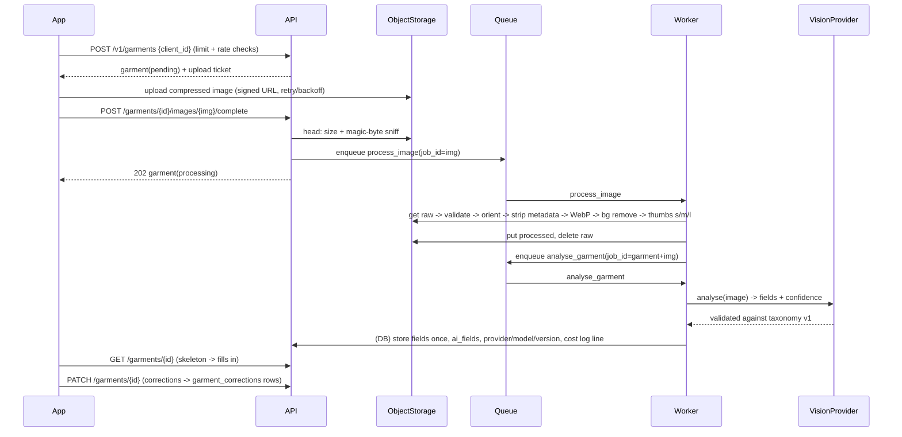

# Phase 2 plan: Digital Closet

Goal: adding a garment takes **under 20 seconds** and the AI fills in the details. Browse, filter, edit, manage. No recommendations
(Phase 3), no payments (Phase 6). Every external dependency is behind an interface with a fake that needs no account; real adapters are
built and marked **unverified**. Nothing in tests or CI calls a live service.

## 1. Architecture

```mermaid
flowchart LR
  subgraph Phone
    CAM[Camera / library<br/>ImageSource] --> CMP[Compress + resize<br/>ImageProcessor]
    CMP --> Q[(Upload queue<br/>persisted, idempotent)]
    Q -->|1 POST /v1/garments {client_id}| API
    Q -->|2 PUT/POST signed URL| STORE
    Q -->|3 POST .../complete| API
    UI[Closet UI<br/>grid, review, detail] -->|poll / refresh| API
  end
  subgraph Backend
    API[FastAPI /v1] -->|enqueue process_image| RQ[(Redis queue<br/>arq)]
    RQ --> W[Worker<br/>python -m app.worker]
    W --> PIPE[Image pipeline<br/>validate, orient, strip EXIF,<br/>HEIC->WebP, bg removal, 3 thumbs]
    PIPE --> STORE[(ObjectStorage<br/>LocalDisk | S3)]
    W -->|enqueue analyse_garment| RQ
    W --> VP[VisionProvider<br/>Fake | Claude]
    W --> DB[(Postgres)]
    API --> DB
    API -. signed read/upload URLs .-> STORE
  end
```

### Job flow (one garment)



Failure paths: transient errors retry with exponential backoff (max 3 tries); after that the job is **dead-lettered** (Redis list
`dlq:closet` + `analysis_jobs.status = dead`) and the garment becomes `needs_manual` so the user can type the details. Jobs are idempotent
(job id = image id / garment id; handlers check state first), so retries and duplicate enqueues never duplicate work or rows.

## 2. Data model (Alembic `0005`)

| Table | Key columns |
|---|---|
| `garments` | id, user_id (fk, indexed), client_id (unique per user), category, subcategory, primary_color, secondary_color, pattern, formality (1-5), seasons (JSON), fit, material, brand, notes, favorite, availability (`available`/`laundry`/`lent`/`repair`), unavailable_until, archived_at, reviewed_at, analysis_status (`pending`/`processing`/`analysing`/`done`/`needs_manual`), ai_fields (JSON: field -> {value, confidence}), analysis_provider/model/version, taxonomy_version, is_sample, sample_asset, cover_image_id, created_at, updated_at |
| `garment_images` | id, garment_id, user_id, status (`awaiting_upload`/`uploaded`/`processing`/`ready`/`failed`), raw_key, full_key, thumb_s/m/l_key, width, height, bytes, content_type, source_name, sha256, created_at, uploaded_at, processed_at, error |
| `garment_corrections` | id, garment_id, user_id, field, ai_value, user_value, taxonomy_version, created_at (feedback for later evaluation) |
| `analysis_jobs` | id, garment_id, user_id, image_id, kind, status (`queued`/`running`/`succeeded`/`failed`/`dead`), attempts, provider, model, latency_ms, input/output tokens, cost_usd, error, created_at, finished_at |

Indexes: `(user_id, category)`, `(user_id, primary_color)`, `(user_id, created_at, id)`, `(user_id, updated_at, id)`, `(user_id, formality)`,
unique `(user_id, client_id)`. Every query is `WHERE user_id = :me`; images and signed URLs are generated only after an ownership check.
Storage keys are `g/<garment_id>/<image_id>/<variant>.webp` (not tied to the user id, so a guest -> account merge only re-points rows).

## 3. Taxonomy (single source of truth)

`taxonomy/garment_taxonomy.v1.json`: categories + subcategories (with which departments see them), fixed colour palette with hex, patterns,
seasons, fits, materials, formality scale, field rules, which fields the AI fills. `tool/gen_taxonomy.py` generates, and CI diffs:
`api/app/domain/taxonomy_data.py`, `app/lib/features/closet/domain/taxonomy_data.dart`, the `tax*` ARB keys, and the Dart label switch. The vision prompt
and the JSON schema handed to the model are built from the same data. Version bump = new file + migration notes.

## 4. API (all under `/v1`, in `docs/openapi.json`)

| Method | Path | Purpose |
|---|---|---|
| GET | `/taxonomy` | taxonomy document (public) |
| GET | `/entitlements` | plan, limits (from flags), usage |
| POST | `/garments` | create garment + upload ticket (idempotent on `client_id`; enforces item limit + upload rate limit) |
| POST | `/garments/bulk` | up to 20 at once (flag `closet_bulk_add_enabled`) |
| POST | `/garments/{id}/images/{image_id}/upload-url` | fresh ticket after expiry |
| POST | `/garments/{id}/images/{image_id}/complete` | validate upload, enqueue processing (202) |
| GET | `/garments` | filters: category, subcategory, color, season, formality_min/max, q, favorite, availability, archived; sort; cursor pagination |
| GET | `/garments/summary` | counts by category/subcategory, totals, limit (feeds browse header + completeness meter) |
| GET | `/garments/{id}` | detail with signed image URLs, analysis state, `excluded_from_outfits` |
| PATCH | `/garments/{id}` | edit fields, favorite, availability, archive, mark reviewed; records corrections |
| DELETE | `/garments/{id}` | hard delete incl. stored images |
| POST | `/garments/{id}/reanalyse` | explicit re-analysis (rate limited) |
| POST | `/garments/sample` | seed the guest sample closet (bundled images, no upload) |

Error codes added: `item_limit_reached` (403, details: limit, count), `rate_limited` (429), `unsupported_media` (415), `file_too_large` (413),
`image_invalid` (422), `bulk_disabled` (403), `bulk_too_large` (422), `usage_cap_reached`. Local-storage routes `PUT /storage/upload/{token}` and
`GET /storage/read/{token}` exist only when `LocalDiskStorage` is selected (dev/test) and are not in OpenAPI.

Flags: `closet_bulk_add_enabled` (true), `closet_item_limit_free` (30), `vision_provider` (`fake` | `claude`, default `fake`).

## 5. Providers (all swappable by config)

| Interface | Default | Real (unverified) |
|---|---|---|
| `ObjectStorage` | `LocalDiskStorage` (HMAC-signed local URLs) | `S3Storage` (presigned POST with size limits) |
| `JobQueue` | `EagerQueue` (tests, inline) / arq on in-process TCP fake Redis (local) | `ArqJobQueue` on real Redis |
| `VisionProvider` | `FakeVisionProvider` (deterministic from filename/hash) | `ClaudeVisionProvider` (Messages API, image input, tool-forced JSON; `VISION_MODEL`, `ANTHROPIC_API_KEY`) |
| `BackgroundRemover` | `PassThroughRemover` | `RembgRemover` (optional extra) |
| App `ImageSource` | camera/picker | fake for tests and simulators |

Cost control: per-user daily analysis cap (`VISION_DAILY_CAP`), per-user upload rate limit, one cost log line per vision call
(`vision_call provider model in_tokens out_tokens cost_usd latency_ms`).

## 6. App screens

Closet grid (filters, search, sort, summary header, completeness nudge) · Capture (outline overlay, brightness hint, crop suggestion, retake, library) ·
Review (photo + editable chips, low-confidence highlight, <=2 taps to correct, skeleton while analysing) · Item detail (edit, favourite, availability, archive, delete) ·
Bulk add (pick <=20, upload queue, review queue, accept all) · Upgrade prompt stub (limit reached) · Upload queue sheet (per-item progress/retry).
Phase 1's first-items step now drives the real flow; "use sample closet" seeds sample garments with bundled images.

## 7. Slices

a taxonomy + schema + storage interface -> b upload pipeline + image worker -> c analysis + fake provider + review -> d browse/filter/detail/availability/delete ->
e bulk add -> f completeness meter + entitlements -> g Claude adapter + eval harness -> h deletion/export extensions, docs, checklist.

## 8. Risks

| Risk | Mitigation |
|---|---|
| Local worker needs Redis but none is installed | arq runs against `fakeredis` TCP server (verified); CI runs a real Redis service for the arq integration test |
| HEIC decoding differs by platform | `pillow-heif` wheels; HEIC fixtures generated in tests; client also converts to JPEG before upload |
| Vision accuracy unknown until real photos | eval harness + targets (category 92%, colour 85%, formality +-1 80%); correction feedback table |
| 500-item scroll performance cannot be profiled without a device | lazy `SliverGrid`, correct thumbnail size per cell, cache keys independent of signed URLs; API p95 measured in tests |
| Merging guest closets with an existing account may exceed the free limit | merge never deletes; adding is blocked until under the limit |
| Cost runaway | per-user caps, cost log line, cap tests |
| Export size with images | ZIP built on disk, streamed; images only for the requesting user |
